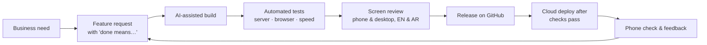

# AI Business Assistant: Product & QA Case Study

> **Confidential client project.** The product name, client, code and screens are private. This case study describes
> my role, process and results only.

**Role:** Product Lead (AI-assisted development) · **Location:** UAE · **Period:** Oct 2026 – present
**Platforms:** Android, iPhone and web · **Languages:** English and Arabic (right-to-left)

---

## The problem
Small UAE businesses handle customer messages on WhatsApp and email, track deals in spreadsheets, and check their
accounting software separately. Replies are slow, follow-ups are forgotten, and nobody has one view of the day.

## What we built (in plain terms)
An AI assistant that brings this work into one app:

- **One inbox** for WhatsApp and email, with an AI-drafted reply for every message
- **Approval rules:** routine replies can go out; anything about prices, payments or complaints waits for a person
- **AI-suggested tasks:** the assistant reads customer messages (English and Arabic) and suggests the next step, such
  as sending a quote, chasing documents or checking a payment. A person adds or dismisses each one.
- **A simple CRM** (people, organisations, deals pipeline) the assistant can answer questions about
- **Read-only accounting views** from popular accounting systems: who owes money, which invoices are late
- **A full Arabic version**, right-to-left, chosen per person

## My role
I led the product day to day and built it with an AI coding assistant (Claude):

- Turned business needs into small, clear feature requests and set the order of work
- Reviewed every release on phone and desktop, gave design feedback and asked for fixes
- Checked automated test results and investigated failures in the release pipeline
- Managed releases on GitHub and hosting on a cloud platform
- Prepared the live demo and visitor experience for a UAE AI product event (Dec 2026)

## How I worked

- **Small releases:** one feature at a time, tested, released, checked on a real phone
- **"Safest first" ordering:** features that only read data came before features that act for the user
- **Human in the loop:** the AI suggests; a person approves anything that reaches a customer

## Quality and testing
- **290+ automated tests** run on every release: server logic, real-browser flows on four screen sizes, and speed budgets
- **Accessibility (WCAG 2.2 basics)** checked after every browser step: every button, field and image is labelled
- **Security checks** based on the OWASP Top 10 (web and AI): injected script in names and messages, oversized requests,
  request floods and prompt-injection attempts in customer messages
- **Performance:** tested with large data (thousands of contacts, deals and emails) and a simulated slow phone

## Results
| Area | Outcome |
|---|---|
| Speed | App start-up on a slow phone improved by about 30% (4.2 s → 3 s) |
| Reliability | Fixed a release-blocking performance failure by finding the root cause (code loading order) |
| Reach | Full Arabic, right-to-left version for the UAE market |
| Safety | No message reaches a customer without the approval rules; AI suggestions always need a person |
| Event | Self-service demo with guest logins for visitors (QR code), resettable in one tap |

## Skills demonstrated
`Product ownership` · `Requirements & prioritisation` · `QA & release testing` · `Accessibility (WCAG)` ·
`Security awareness (OWASP)` · `UX review` · `AI-assisted development` · `Localisation (Arabic / RTL)` ·
`GitHub` · `Cloud hosting` · `Data quality`

## What I learned
- Writing precise requests ("done means…") is what makes AI-assisted development fast and reliable
- Measuring first (profiles, timings) finds the real cause; guessing fixes symptoms
- Accessibility and security checks are cheapest when they run automatically on every release

---
*Contact: [linkedin.com/in/hamzawahab](https://www.linkedin.com/in/hamzawahab/) · muhammadhamzawahab@gmail.com*
